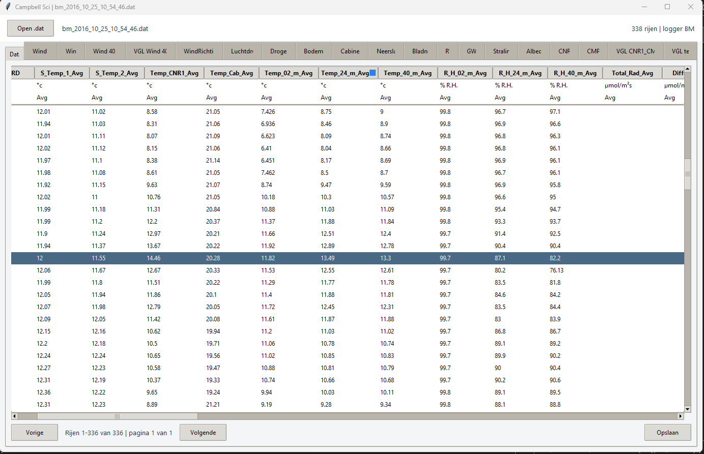
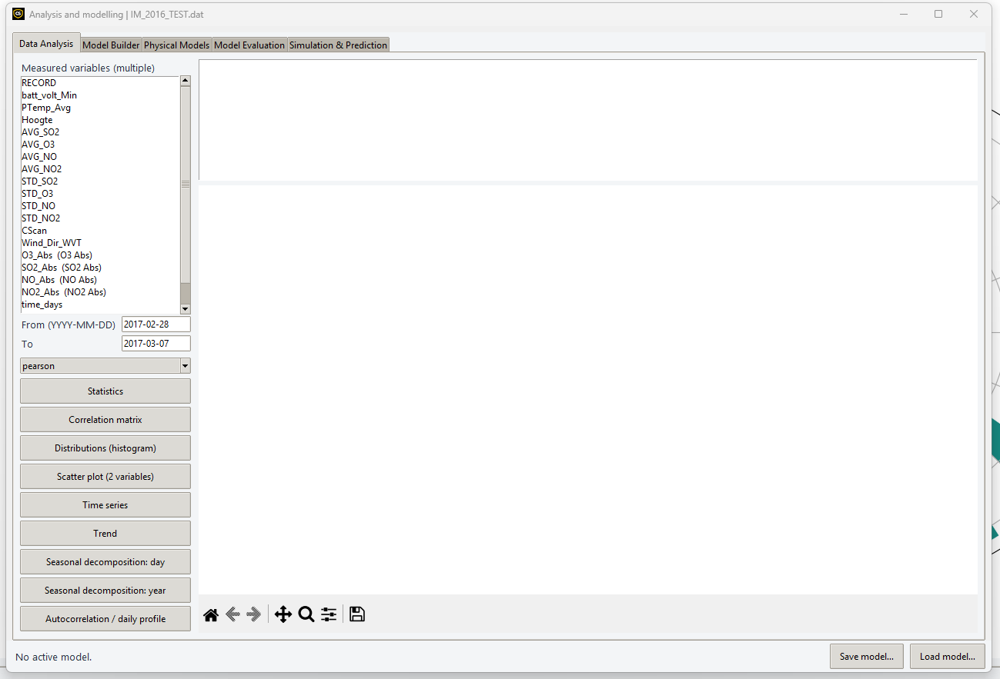
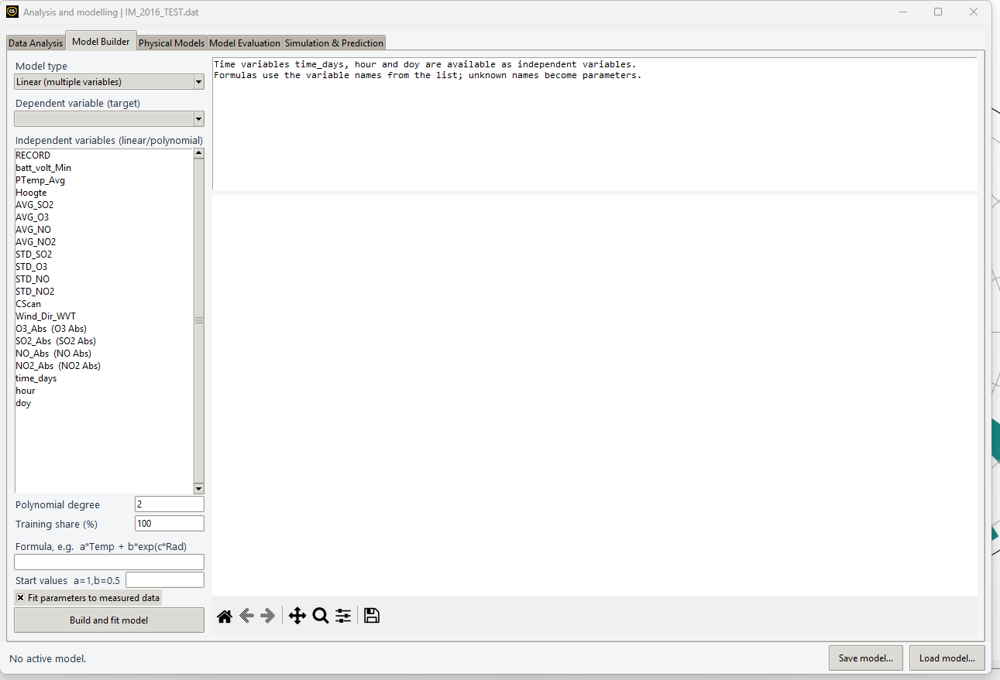
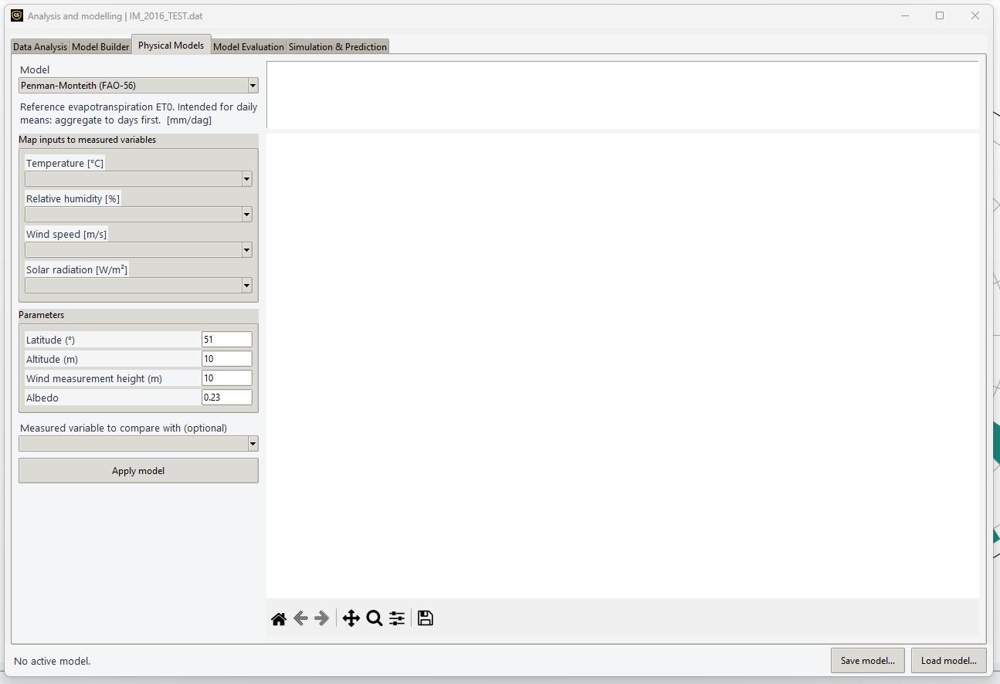
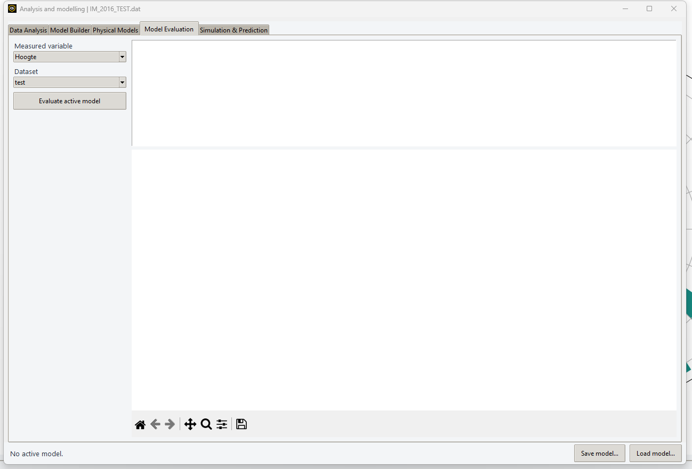
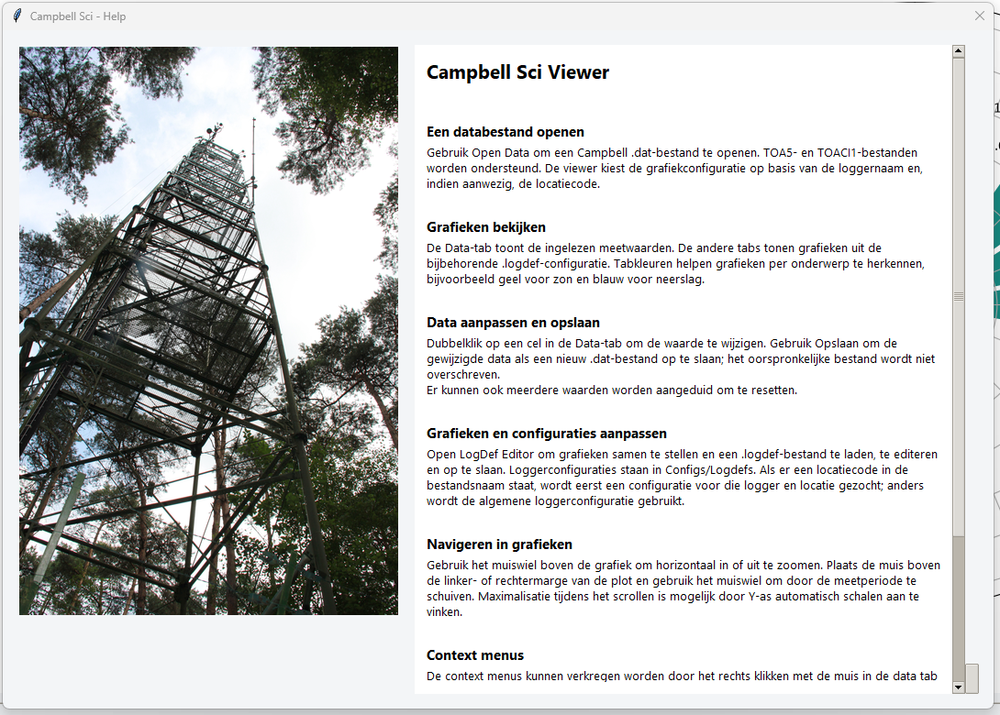

# Campbell Sci Viewer

A standalone Windows application for viewing and editing Campbell Scientific
data files.

Screenshots below illustrate the features; some show an earlier interface.

## Download and start

1. Download the [latest onefile release](https://github.com/EddySoc/Campbell-Sci/releases/latest/download/Campbel.Sci.Viewer.zip) and extract it.
2. Open the extracted `CampBell Viewer` folder.
3. Run `Campbel Sci Viewer.exe`.

The ZIP includes an example `Configs` folder next to the single-file (onefile)
executable. Keep it there and adapt its settings to your own data. Missing
configuration files are restored from the executable on startup without
overwriting existing files. When updating, preserve your customized `Configs`
folder rather than replacing it with the examples.

## Open and view data

Use **Open Data** to open a Campbell `.dat` file (TOA5 or TOACI1) or a general
`.csv`/`.txt` measurement file. For general files, the first line must contain
the column names. Comma, semicolon, and tab delimiters and decimal commas are
detected automatically; a date/time column is used as the time axis.

The **Data** tab shows the measurements, the **Calc** tab shows calculated
columns, and the other tabs show charts from the matching logger configuration.
If no chart configuration is found, the viewer creates a line chart for each
numeric measurement column.
The tab strip can be scrolled with the arrow buttons or the mouse wheel.

**Measurement data**



Use the mouse wheel over a chart to zoom horizontally. Place the pointer over
the left or right plot margin and use the wheel to scroll through the
measurement period. Hover over a line to see its column, time, and value.

**Zooming and navigating a chart**


## Edit measurements and charts

Double-click a cell in the **Data** tab, or select it and press Enter, F2, or
start typing, to edit its value. Select multiple cells with the mouse or with
Shift and the arrow keys; press Delete to clear the selection. **Save** writes
the modified data to a new `.dat` file and does not overwrite the original.
The **Calc** tab is read-only, but its values can be selected and copied with
Ctrl+C.

Use **LogDef Editor** to create or edit chart configurations. They are stored
in `Configs/Logdefs`. The viewer first looks for a logger-and-location
configuration, then a logger-wide configuration. A graph is split by height
only when `Hoogte` is explicitly included in that graph's `.logdef`; add
`@secondary` to a measurement column to plot it on the second Y axis.
**Save** closes the editor and refreshes charts immediately; existing files are
saved directly, while new configurations require a file choice. **Save as**
remains available, but a file outside the active logger/location configuration
is not automatically applied.

**LogDef Editor**


**Chart examples**

Series on the same plot:


Series on separate plots:


A chart with a secondary axis:


Wind rose:


A wind rose can also show concentrations per wind direction. Put the wind
direction first in the chart's columns and add one or more concentration
columns (for example `NO` and `NO2`). Each wind sector then shows the mean
concentration for winds from that direction, as grouped bars. The columns may
come from Data, Calc or Pivot; if the direction and the concentration are
Pivot columns, they must use the same period.


Charts that cannot be built (for example because their columns contain no
data or were removed) are not shown; one message lists all of them.

For scatter charts choose exactly two columns, first Y and then X; this order
preserves existing configurations. Optionally enable a linear trendline with
its equation and R². At least two valid points with different X values are
needed; R² is undefined when Y is constant.
The **Grouped bars** type displays series side by side; **Min-mean-max bars**
displays the range from minimum to mean and mean to maximum, with a marker for
the mean. Add exactly three columns one at a time in minimum, mean, maximum
order, on the same time basis. Values must satisfy minimum ≤ mean ≤ maximum.
**Min-mean-max per sensor** displays one such range bar per sensor, grouped side
by side at each timestamp. Add each sensor's minimum, mean and maximum columns
as a consecutive triple.
The dark zero line makes negative values visible. A Pivot mean uses all
available measurements in the period, not just the minimum and maximum.
Use **Up** and **Down** below the selected columns to change their order.
All bar types add the time column automatically and leave existing bar charts
unchanged.

## Formulas and custom functions

**Formula Editor**


Use **Formula Editor** to add calculated columns. Refer to a measurement by
putting its column name in square brackets, for example:

```text
[Temp_02_m_Avg] * 1.8 + 32
IF([Regen] > 0; 1; 0)
DAGGEM([Temp_02_m_Avg])
```

Formulas are evaluated for each measurement row and can use columns from the
**Data** and **Calc** tabs. Built-in functions include row-wise arithmetic
(`SUM`, `SUBTRACT`, `PRODUCT`, `DIVIDE`, `MIN`, `MAX`, `AVERAGE`), conditions
(`IF`, `AND`, `OR`, `NOT`), maths, daily summaries, and time-series functions.
Function arguments can be separated with commas or semicolons. Dutch aliases
are also available. Open the in-app Help for the full function reference and
examples.

Use **Edit custom functions...** to edit `Configs/Functiedefs/Functies.funcdef`.
Use **Edit function catalog...** to edit function groups, colors and visibility.
Both text editors provide case-insensitive search with Previous/Next navigation
and Ctrl+F. Formulas and custom functions are stored in `Configs/Formuladefs`
and `Configs/Functiedefs`.

**Custom functions editor**


**Function catalog editor**


**Choose visible functions**


## Add, remove and reorder columns

Use **Add columns** to add columns from another file of the same measurement
period (for example IM_, WX_ or PA_ columns to a BM_ file). Choose the file,
then the columns. The files are matched on identical timestamps; if no
timestamp matches at all, a message is shown and nothing is added. Duplicate
column names are prefixed with the logger name (for example `IM_T`).


Use **Manage columns** to move columns up or down or delete them, then choose
**Apply**. Deleted columns also disappear from charts and Pivot definitions
(a chart without any remaining series is removed). **Save** writes the result
to a new file.

## Analysis & Modelling

**Analysis & Modelling** opens a window for further research of the loaded data
(needs `scipy`). It has five tabs:

- **Data Analysis**: select variables, statistics, correlations and distributions.

  

- **Model Builder**: build a model (linear, polynomial or your own formula) for a
  dependent variable as a function of time and other variables.

  

- **Physical Models**: Penman-Monteith, Hargreaves, water balance, Newtonian
  cooling, pressure correction and a Gaussian plume model.

  

- **Model Evaluation**: compare model and measurements with R², RMSE, MAE, bias
  and residual analysis.

  

- **Simulation & Prediction**: change parameters or inputs (for example +2 °C)
  and see how the model responds.

  

Models can be saved and loaded with **Save model** and **Load model**
(`Configs/Modeldefs`, `.modeldef`). All texts of the add-on are in the
language files.

## Pivot tables

Use **Pivot Editor** to define named columns from Data or Calc. Choose the
source, aggregation (mean, sum, minimum, maximum, count or median) and period
(15 seconds, 30 seconds, 1, 5, 10, 15 or 30 minutes, hour, day, week, month or
year). Each result has one timestamp at the
start of its period; weeks start on Monday. Missing numeric values are excluded
from the calculations. Definitions are saved per logger and location in
`Configs/Pivotdefs`, with the same fallback rules as formulas.

The **Pivot** tab shows columns for the selected period, with paging and
copyable cells. **Pivot Formulas** opens a separate formula editor for that
period; these formulas operate on the period's Pivot rows rather than on the
original measurements and are saved in `Configs/PivotFormuladefs`. Pivot columns
can be reordered with **Up** and **Down** in Pivot Editor. Column names
must be unique across Data, Calc and all Pivot periods. Pivot and Pivot-formula
columns are available in LogDef Editor. Line and bar charts use each series'
own timestamps, so measurements and daily summaries can share a time axis
without repeating daily values. Scatter plots match series on exact timestamps.

## Language and configuration

Choose the interface language with the selector on the toolbar; the choice is
saved. Language files are in `Configs/Langdefs` (`<code>.langdef`). Optional
translated help files can be placed in `Configs/Helpdefs` as
`Campbell_Sci.<code>.helpdef`. The English help text is
`Configs/Helpdefs/Campbell_Sci.en.helpdef`.

**In-app help**



Menu configurations are in `Configs/Menudefs`. Configuration files can be
adapted directly; names of functions and charts in user configurations are not
translated.

## Run from source

Requires Python 3.11 or newer. From the repository root, install the runtime
dependencies and start the viewer:

```powershell
python -m pip install -r requirements.txt
python .\src\main.py
```
